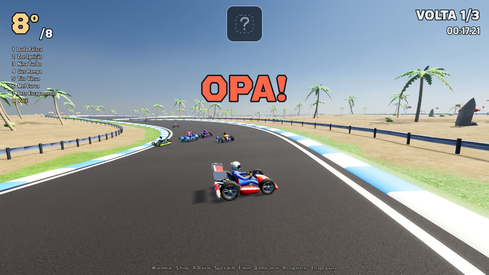
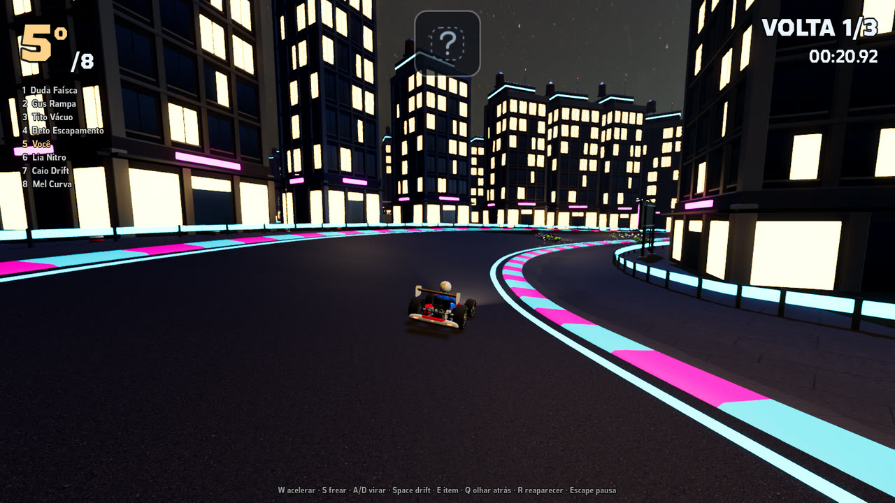
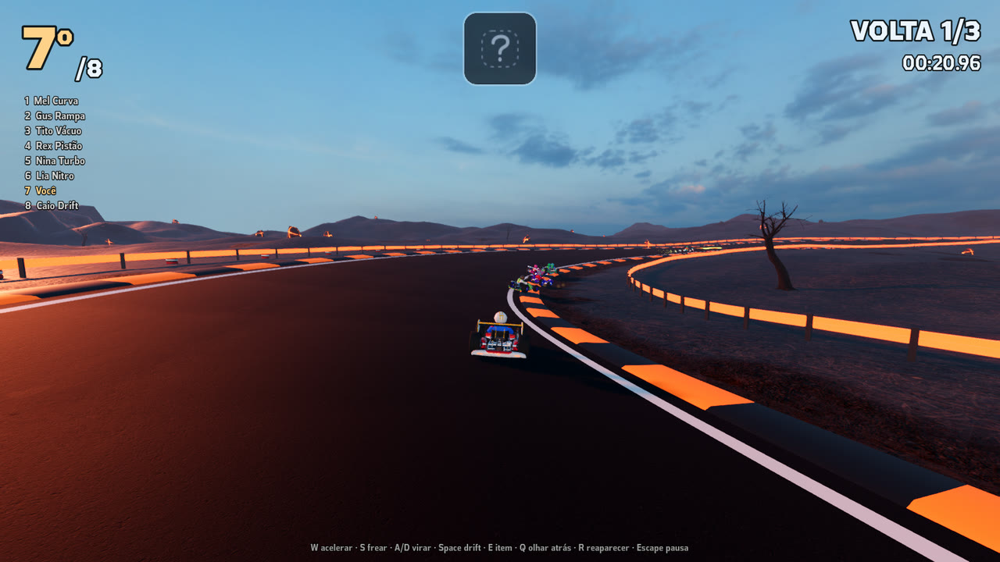
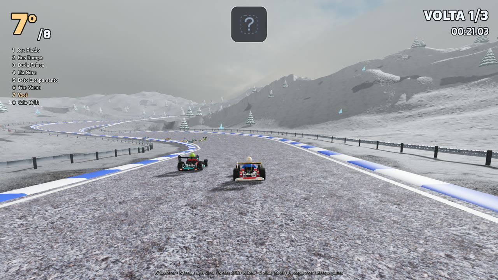
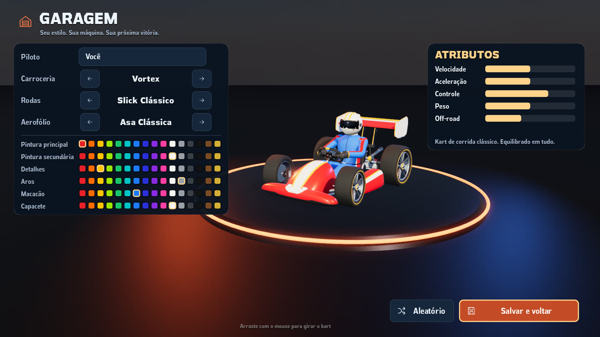
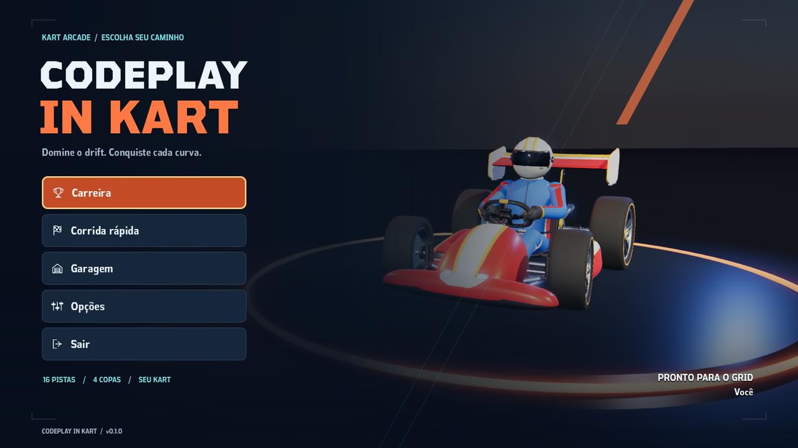
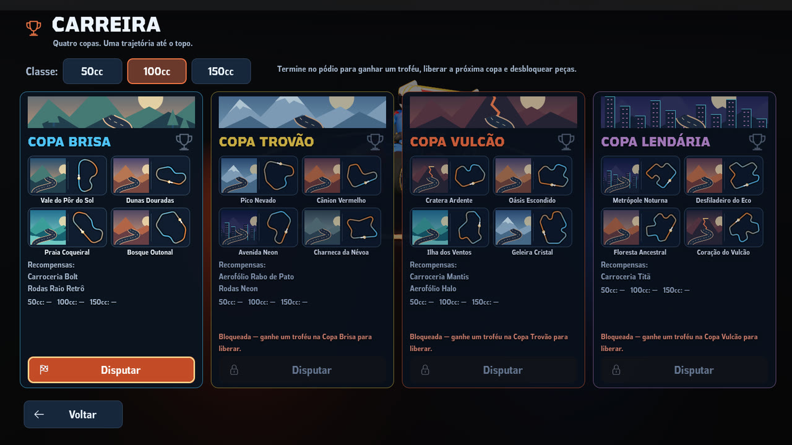

# Codeplay in Kart 🏁

[](CHANGELOG.md)
[](LICENSE)
[](https://godotengine.org/)
[](https://codeplay.com.br)

Jogo de **kart arcade open-source** feito com **Godot 4.7** e **Blender 5.1**:
drift com mini-turbo, itens, pulos, IA competitiva e **karts totalmente customizáveis**.

Um projeto do **CodePlay**. Conheça mais em **[codeplay.com.br](https://codeplay.com.br)**.

> *Open-source arcade kart racer made with Godot 4.7 and Blender 5.1: drift boosts,
> items, jumps, competitive AI and fully customizable karts. Public domain (CC0).
> Contributions welcome!*



## Imagens

| | |
|---|---|
|  |  |
| **Avenida Neon** | **Cratera Ardente** |
|  |  |
| **Pico Nevado** | **Garagem** |
|  |  |
| **Menu principal** | **Modo carreira** |

## Destaques

- **Física arcade própria**: colisão por esfera + controle de velocidade frente/lateral,
  aderência alta normal e deslizante no drift, turbo e rodada ao ser atingido.
- **Drift com 3 níveis de mini-turbo** (faíscas azul → laranja → roxo).
- **Turbo de largada**: acelere no último instante da contagem.
- **Itens**: Turbo, Orbe (ricocheteia nas paredes e persegue o kart à frente) e Mina.
- **Garagem**: carroceria, rodas, aerofólio e 6 cores (pintura principal/secundária, detalhes,
  aros, macacão, capacete). Cada peça altera **velocidade, aceleração, controle, peso e off-road**.
- **IA** com faixas próprias, drift, uso de itens, destravamento e equilíbrio leve (*rubber band*).
- **16 pistas em 9 temas**: vale, deserto, praia (com mar), outono, neve, cânion, cidade neon
  à noite (postes, guard-rails neon, faróis nos karts), charneca com neblina e vulcão (com lava).
  Asfalto, zebras, inclinação nas curvas, terreno, guard-rails e decoração são gerados a partir do traçado.
- **Modo carreira**: 4 copas × 4 corridas, classes 50cc/100cc/150cc, pontuação por corrida,
  pódio 3D com troféus (ouro/prata/bronze), copas e **peças desbloqueáveis** (Bolt, Mantis, Titã,
  rodas Raio Retrô e Neon, aerofólios Rabo de Pato e Halo).
- **Opções**: modo de tela, resolução, VSync, limite de FPS, escala 3D (FSR2), qualidade gráfica
  (Baixa/Média/Alta/Ultra), volumes, câmera, km/h ou mph, minimapa, contador de FPS e
  **remapeamento de teclas**.
- **Todos os modelos 3D são gerados por scripts do Blender** (`tools/blender/`), reproduzíveis e fáceis de estender.
- **Áudio**: motores com marchas a partir de loops gravados, trilha com transições suaves e efeitos sonoros CC0.

## Como jogar

1. Instale o [Godot 4.7](https://godotengine.org/) (versão padrão, sem .NET).
2. Abra o Godot → **Importar** → selecione o `project.godot` desta pasta.
3. Pressione **F5**.

| Ação | Teclado | Controle |
|---|---|---|
| Acelerar | W / ↑ | A / RT |
| Frear / ré | S / ↓ | B / LT |
| Virar | A D / ← → | Analógico esquerdo / D-pad |
| Drift (segure) | Espaço / Shift | RB / LB |
| Usar item | E / Ctrl | X / Y |
| Olhar para trás | Q | R3 |
| Reaparecer na pista | R | Back |
| Pausa | Esc / P | Start |

**Dica de drift:** segure o drift enquanto vira. Quanto mais tempo derrapando (e mais fechado),
maior o nível do mini-turbo. Solte para ganhar o impulso.

## Estrutura

```
assets/          modelos (.glb), texturas, fontes, áudio, ícones
docs/            guias de assets, áudio, interface e capturas de tela
scenes/          cenas (menu, garagem, corrida, pistas)
scripts/
  audio/         ganhos medidos das músicas
  autoload/      estado global, controles, configurações, música e sons
  kart/          física, visual modular, catálogo de peças, IA, áudio do motor
  track/         gerador de pista, temas, shaders, caixas de item, placas de turbo
  race/          gerenciador da corrida e câmera
  items/         orbe, mina, efeitos
  ui/            HUD, menu, garagem, opções, tema
tools/
  audio/         tratamento e medição do áudio
  blender/       scripts que geram todos os modelos 3D
  track_gen/     gerador de traçados
  ui/            geração de ícones e ilustrações
```

## Regerar os modelos 3D

```bash
blender --background --factory-startup --python tools/blender/build_karts.py
blender --background --factory-startup --python tools/blender/build_props.py
```

Para criar uma peça nova (carroceria, roda, aerofólio), siga o [contrato de assets](docs/ASSET_CONTRACT.md)
e registre-a em `scripts/kart/kart_catalog.gd`.

## Criar uma pista nova

**Pelo gerador de traçados** (recomendado):
1. Adicione uma entrada em `TRACKS` de `tools/track_gen/generate_layouts.py` com um gabarito
   (polígono simples em metros), tema, elevação e raio mínimo de curva.
2. Rode `python tools/track_gen/generate_layouts.py --preview previa.png`. Ele procura uma variação
   válida (raio de curva, distância entre trechos, inclinação, reta de largada) e escreve
   `scripts/track/track_layouts.gd`.
3. Registre a pista em `scripts/track/track_catalog.gd` (nome, tema e sobrescritas visuais) e,
   se quiser, coloque-a numa copa.

**À mão**: estenda `Track` (veja `scripts/track/sunset_valley.gd`) e aponte `"scene"` no catálogo.

Temas novos ficam em `scripts/track/track_themes.gd` (céu, sol, neblina, texturas, relevo,
água/lava, postes de luz e regras de vegetação).

## Roadmap

- [ ] Multiplayer local em tela dividida
- [ ] Modo contra o tempo com fantasma e recordes por pista
- [ ] Mais itens e escudo
- [ ] Decalques/adesivos e mais peças na garagem

## Versões

O histórico de mudanças está no [CHANGELOG](CHANGELOG.md).

## Como contribuir

Veja o [guia de contribuição](CONTRIBUTING.md).

## Licença

Este projeto está em **domínio público** sob a [CC0 1.0 Universal](LICENSE): código, modelos 3D,
arte da interface e áudio criados para o jogo. Você pode copiar, modificar e distribuir, inclusive
para fins comerciais, sem precisar pedir permissão.

Fontes, texturas, HDRIs, músicas e efeitos sonoros de terceiros também são CC0. A lista completa
está em [CREDITS.md](CREDITS.md).

---

Feito por **CodePlay** · [codeplay.com.br](https://codeplay.com.br)
